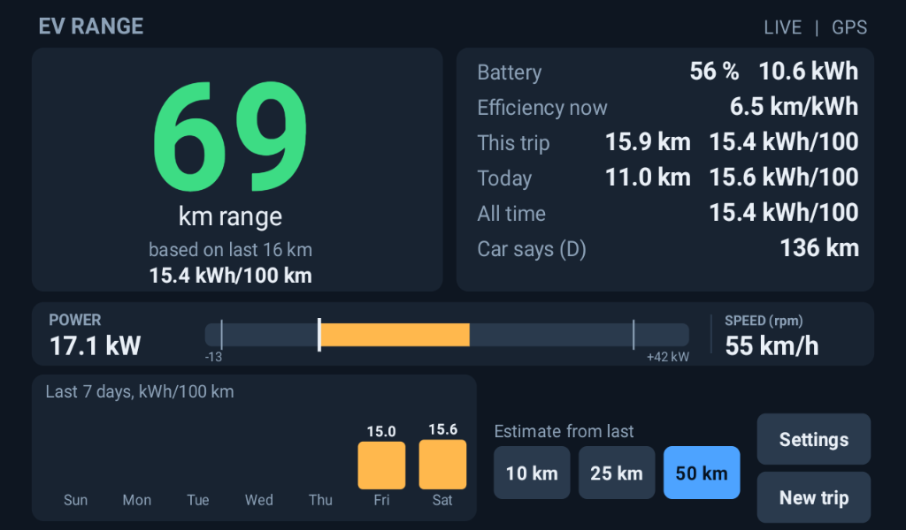

# EV Range for a Lingbox head unit

A real-world range estimate for one specific small EV, computed from **what you actually drove recently** instead of the lab-cycle figure the car shows. It runs on the car's Android head unit (Lingbox, "Octapro 8529", board `825X_Pro`).

> **Experimental hobby project. Read [docs/SAFETY.md](docs/SAFETY.md) before installing anything.**
> One part of it runs inside the head unit's main program and crashed it repeatedly during development before it was redesigned. It is **not** a safety system. Never rely on it alone for range planning.



*Screenshot from the car's head unit. The power (17.1 kW) and speed (55 km/h) strip is taken from a recorded sample drive, because the car was parked when the picture was taken; everything else is live.*

## What is in here

| Folder | What it is |
|---|---|
| `app/` | **EV Range app**: the screen (range, kWh/100 km, trip / day / all-time averages, 7-day chart, a live power bar scaled to this car's measured limits, speed, the car's own range and drive mode D/S, rated-range comparison; a red glow at the screen edges in S). A normal Android app in its own process. |
| `hook/` | **Data feed** (`com.ts.evhook`): reads battery voltage, current, SOC, temperatures and motor rpm from the car through the head unit's own software and writes a small CSV, plus a read-only log of the air-conditioning state and, on request, switches off the unit's speed-linked volume (its only write). Runs inside `com.ts.MainUI`. Has built-in safety brakes and rotating logs. |
| `probe/` | **Read-only probe** (`com.evprobe.app`, no permissions): shows the unit's own car-info values live (gear, brake, hand brake, ACC, tyre pressure fields, a distance counter, ...) and highlights what changes, to find out what this car actually sends. Calls only the read method of the unit's car-info interface. Never logs the VIN. |
| `tools/` | Analysis scripts, including `calibrate_speed.py` (rpm vs GPS speed) and `vehicle_off_monitor.ps1`. |
| `samples/` | A sanitized sample drive for demo mode and tests. |
| `docs/` | The development log, the TPMS findings, and the install / safety / build guides. |
| `scripts/` | `test.ps1`: all tests that need no device. |

## How it works

```
car CAN bus -> head-unit MCU -> head-unit software (MainUI + libcan59)
                                      |
                  hook (main thread only, safety brakes)
                                      |  writes ev_log.csv (every 2 s while driving, every 30 s idle)
                                      v
                  EV Range app (own process) + GPS -> range estimate
```

- Energy comes from battery voltage x current, so it includes regen and hills.
- Range = remaining energy (capacity x SOC) / consumption over the **last 10 / 25 / 50 km** (selectable). Until there is enough distance it falls back to the trip average, the all-time average, then a default.
- Distance comes from GPS speed when there is a fix, otherwise from motor rpm with a calibrated ratio (see `tools/calibrate_speed.py`).
- With the vehicle off the unit suspends (tested): nothing is logged or sent. (While charging overnight the unit sleeps and logs nothing, so charged energy in the log is an under-count.)
- The app also shows the car's own range and drive mode (D or S, worked out from range per percent), keeps consumption separately for D and S, and can float a small range bubble over other screens (off the reverse camera by default).
- One opt-in write: the feed can turn off the head unit's speed-linked volume at your request (app Settings; see `docs/SAFETY.md`).

**What it found on the test car (four days, 210 km, mostly city driving):** usable energy about 17.9 kWh per 100 % of battery (nominal 19.14 kWh); 12.7 kWh/100 km moving, 14.2 including standing-still drain; best at 40 to 60 km/h (about 9 kWh/100 km); S mode uses about 50 % more than D. That is roughly 125 to 140 km on a full charge in mixed driving, against the car's own 243 km (D) claim. The motor reached 151 °C in repeated full-power runs; the dashboard speedometer reads about 3 to 4 km/h above true speed. Details in `docs/HEADUNIT_EV_HOOK.md`.

## Compatibility: exactly one setup

This is built and tested **only** for:

| Item | Value |
|---|---|
| Head unit | Lingbox "Octapro 8529", board `825X_Pro` (alps / MediaTek-style), Android 9 (SDK 28) |
| Head-unit software | `com.ts.MainUI` versionName 1.1, APK SHA-1 `98d77350d621b09831bde02cdbf02409589cdf30` |
| Car CAN profile | type 356 (Jimai FL), subtype 3 (`Can_Com_Para.bin` = `64 01 03 00 00 00 00 00`) |
| Battery | 19 kWh (edit in app Settings) |

On anything else the hook may not install, may do nothing, or may behave unpredictably. The preflight checks in [docs/INSTALL.md](docs/INSTALL.md) exist to catch that; do them.

## Quick start

```powershell
.\scripts\test.ps1          # tests, no device needed
.\app\build.ps1             # build\app\evrange.apk   (debug-signed; use your own key to distribute)
.\hook\build.ps1            # build\hook\evhook.apk   (AOSP platform key: see docs/BUILD.md)
.\probe\build.ps1           # build\probe\evprobe.apk (read-only, no permissions)
```

Then follow [docs/INSTALL.md](docs/INSTALL.md) step by step (it verifies checksums at each step and explains how to undo everything).

## Calibrating the distance

The unit gives no vehicle speed in km/h, so distance needs a calibrated rpm-to-speed ratio. The measured ratio on the test car is **31.0 km/h at 3000 rpm** (0.0001722 km per motor revolution, checked against GPS to 0.6 % over a 31-minute drive); it is the app's default. To check it on your own unit, drive with the app open, pull `gps_rpm_log.csv` from `/storage/emulated/0/Android/data/com.evrange.app/files/`, run `py -I tools\calibrate_speed.py gps_rpm_log.csv`, and enter the printed "speed at 3000 rpm" in the app's Settings. Details in the development log, section 15.

## What is deliberately not in this repository

The manufacturer's own files (`MainUI.apk`, its native libraries, decompiled code), signing keys and keystores, and raw drive logs. The development log refers to them by name and checksum only. Do not add them. (Check the law where you live before reverse-engineering or redistributing anything of the manufacturer's.)

## Documentation

- [docs/INSTALL.md](docs/INSTALL.md): preflight checks, install, verify, uninstall, kill switch
- [docs/SAFETY.md](docs/SAFETY.md): what can go wrong and how it is contained
- [docs/BUILD.md](docs/BUILD.md): building and testing
- [docs/HEADUNIT_EV_HOOK.md](docs/HEADUNIT_EV_HOOK.md): full development log, findings and decoding tables
- [docs/TPMS_FINDINGS.md](docs/TPMS_FINDINGS.md): how the unit's two tyre-pressure systems work

## License

Apache License 2.0, see [LICENSE](LICENSE). The software comes with no warranty; read [docs/SAFETY.md](docs/SAFETY.md) before installing anything on a car.
